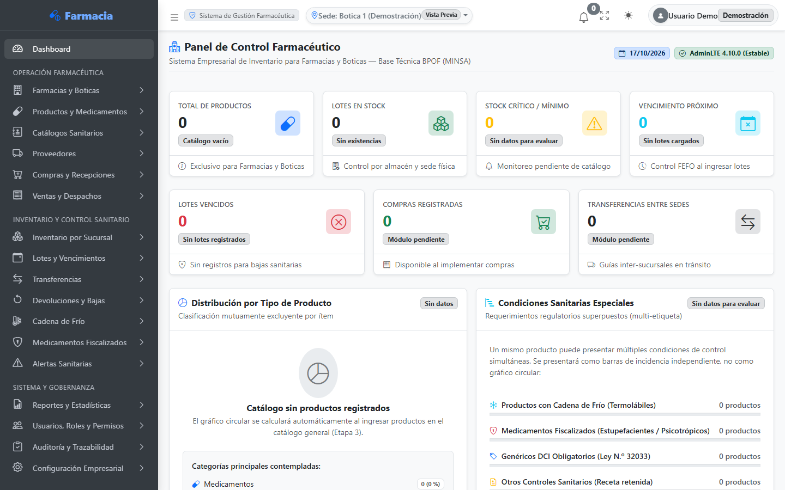
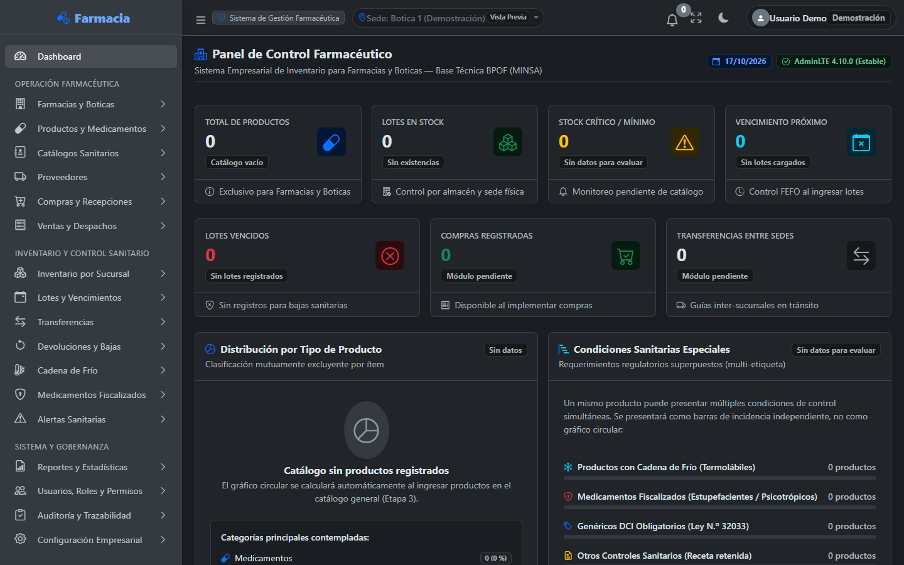
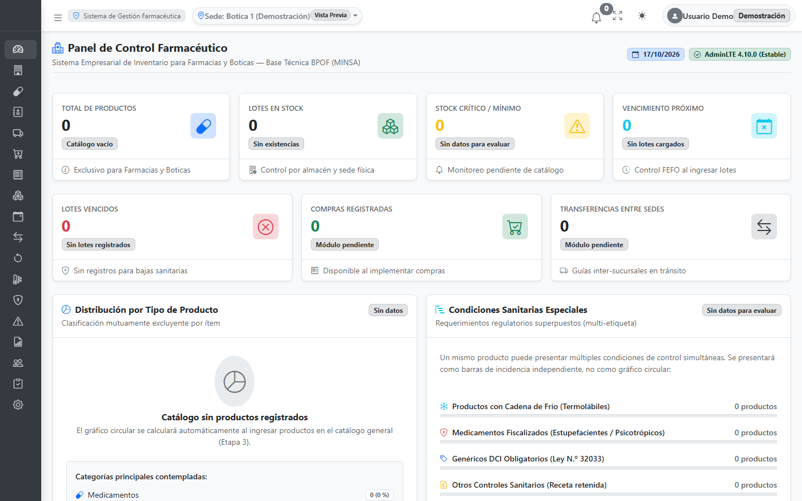
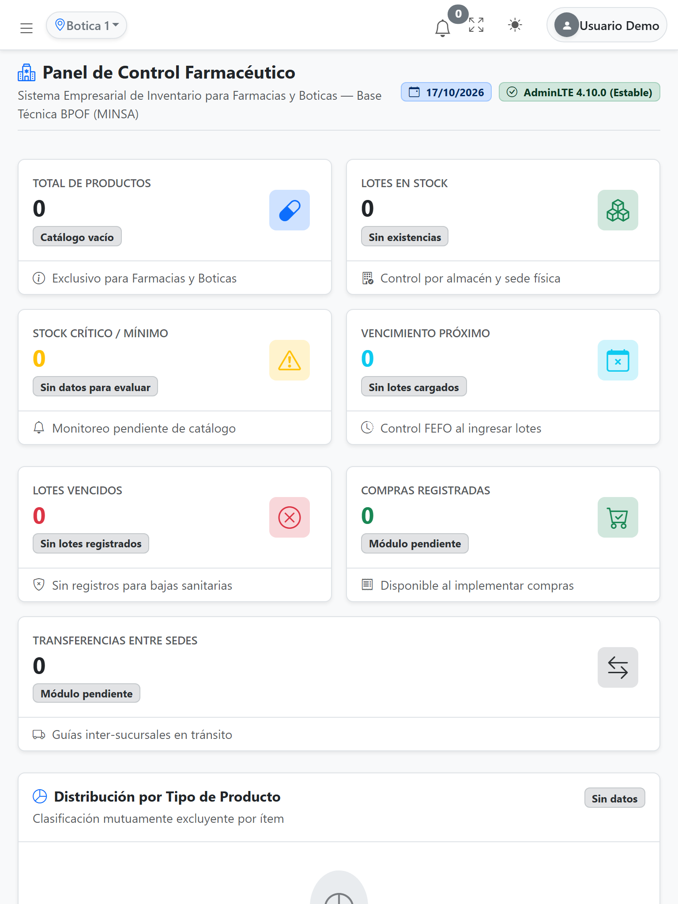
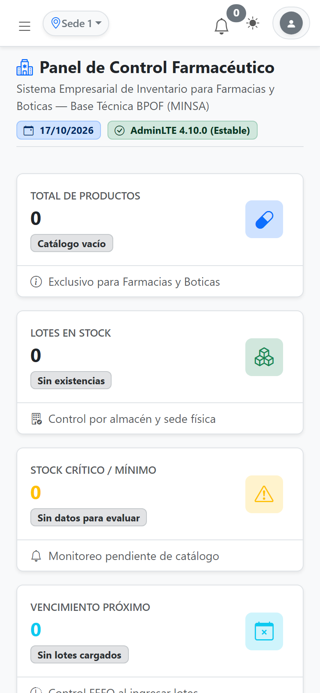
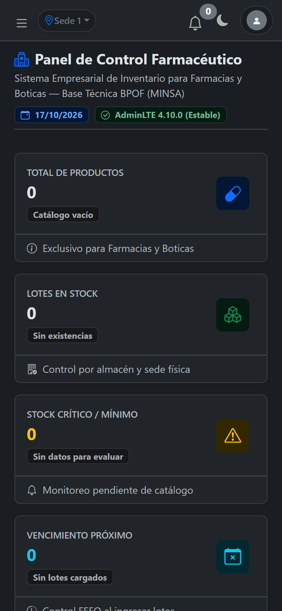
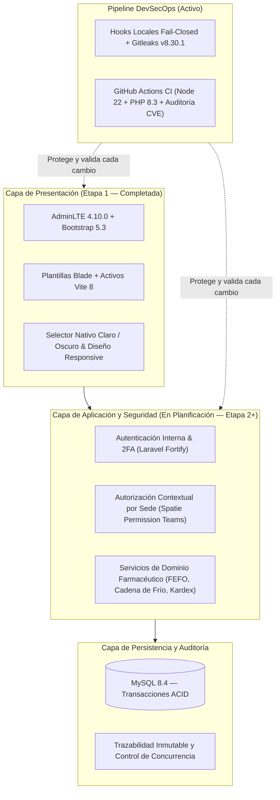

# 💊 Sistema Empresarial de Gestión e Inventario Farmacéutico

**Arquitectura Web Moderna, Trazabilidad Sanitaria FEFO y Gobernanza Multisucursal para Farmacias y Boticas**

  <strong>Repositorio de Portafolio Técnico y Demostración Arquitectónica</strong> 
  <em>Desarrollado bajo prácticas de ingeniería segura (DevSecOps), integración continua y diseño responsive adaptable.</em>

---

## 📋 Descripción General

El **Sistema Empresarial de Gestión e Inventario Farmacéutico** es una plataforma web diseñada específicamente para responder a las exigencias operativas, logísticas y regulatorias de **Farmacias y Boticas** (bajo lineamientos de Buenas Prácticas de Oficina Farmacéutica — BPOF / MINSA / DIGEMID).

A diferencia de un sistema de inventario genérico para comercio minorista, una operación farmacéutica requiere controlar productos por **lote sanitario, fecha de vencimiento (criterio FEFO), registro sanitario, condición de almacenamiento (cadena de frío), medicamentos sujetos a fiscalización y presentaciones indivisibles**. Este proyecto aborda esos desafíos combinando una arquitectura sólida en **Laravel 13 (PHP 8.3)** con una interfaz administrativa moderna basada en **AdminLTE 4.10.0**, **Bootstrap 5.3** y **Vite 8**.

> [!NOTE]
> **Acerca de este repositorio:** Por políticas de seguridad industrial y protección de propiedad intelectual, el código fuente transaccional se mantiene en un **repositorio privado de desarrollo**. Este repositorio público actúa como **portafolio técnico oficial** para presentar la arquitectura, el diseño de interfaz, los estándares de calidad y el avance real del proyecto ante empresas, reclutadores y equipos de ingeniería.

---

## 🖥️ Vista Principal del Sistema

  
  
<em>Panel de Control Farmacéutico en escritorio (1440 px) — Tema Claro nativo con estados iniciales verificados y navegación de 18 módulos sanitarios. (Datos de vista previa demostrativa).</em>

---

## 🖼️ Galería de Interfaz y Adaptación Responsive

La interfaz ha sido construida y validada utilizando los mecanismos nativos de **Bootstrap 5.3 (`data-bs-theme`)** y **AdminLTE 4.10.0**, garantizando legibilidad completa en menús laterales, contraste accesible en modo oscuro y **cero desbordamiento horizontal** desde pantallas de escritorio hasta dispositivos móviles de `360 px` y `390 px`.

### 1. Tema Oscuro Nativo y Menú Colapsable (`Sidebar Mini`)

<table>
  <tr>
    <td width="50%" align="center">
      
       
      <strong>Modo Oscuro Nativo (<code>data-bs-theme="dark"</code>)</strong>
       
      Contraste optimizado para turnos prolongados de dispensación y control de almacén.
    </td>
    <td width="50%" align="center">
      
       
      <strong>Navegación Compacta (<code>Sidebar Collapsed</code>)</strong>
       
      Maximización del área de trabajo operativa conservando acceso rápido por iconografía.
    </td>
  </tr>
</table>

### 2. Diseño Responsive en Tablet y Dispositivos Móviles

<table>
  <tr>
    <td width="40%" align="center">
      
       
      <strong>Vista Tablet (768 px)</strong>
       
      Reorganización automática de tarjetas KPI y compactación inteligente de la barra superior.
    </td>
    <td width="30%" align="center">
      
       
      <strong>Móvil Claro (390 px)</strong>
       
      Encabezados multilínea sin recortes y menú <em>offcanvas</em> táctil.
    </td>
    <td width="30%" align="center">
      
       
      <strong>Móvil Oscuro (390 px)</strong>
       
      Consistencia cromática total en dispositivos de mano para auditorías en anaquel.
    </td>
  </tr>
</table>

---

## 🎯 Problema Empresarial que Resuelve

Las oficinas farmacéuticas (farmacias y boticas) enfrentan riesgos críticos cuando operan con hojas de cálculo o sistemas comerciales genéricos que solo contabilizan cantidades totales por SKU:

1. **Riesgo Sanitario por Vencimiento y Lotes (FEFO):** Un mismo medicamento coexiste en múltiples lotes con distintas fechas de expiración. El sistema está diseñado bajo el principio **FEFO (*First Expired, First Out*)**, priorizando la salida de los lotes más próximos a vencer y bloqueando automáticamente lotes vencidos o en cuarentena.
2. **Integridad de Empaque Primario Sellado:** Control estricto de presentaciones comerciales (cajas, blísteres sellados, unidades indivisibles como frascos, inhaladores o inyectables) para impedir el fraccionamiento no autorizado de envases primarios.
3. **Asignación Multi-Lote en Operaciones:** Una sola línea de venta o transferencia puede requerir existencias provenientes de dos o más lotes físicos distintos, manteniendo la separación entre la cantidad comercial dispensada y los descuentos físicos en el Kardex.
4. **Conservación y Cadena de Frío:** Monitoreo de productos termolábiles (2 °C a 8 °C), registro de lecturas periódicas y gestión de excursiones térmicas sujetas a dictamen técnico del Director Técnico (Químico Farmacéutico).
5. **Cumplimiento Regulatorio Multisucursal:** Segregación de inventario, Kardex y responsabilidades profesionales por cada establecimiento autorizado, contemplando el seguimiento de medicamentos esenciales en DCI y psicotrópicos/estupefacientes.

---

## 🏗️ Arquitectura General del Sistema

El proyecto sigue una arquitectura modular por capas sobre **Laravel 13**, separando claramente la presentación administrativa, las reglas de negocio sanitario y la integridad transaccional de datos:

---

## 🛠️ Stack Tecnológico

Para mantener total transparencia técnica, se distingue entre las tecnologías **actualmente implementadas y operativas en el repositorio** y aquellas **diseñadas en la arquitectura para las siguientes etapas**:

### Tecnologías Implementadas Actualmente (Etapas 0 y 1)

| Categoría | Tecnología | Versión / Detalle | Uso en el Proyecto |
| :--- | :--- | :--- | :--- |
| **Backend Framework** | **Laravel** | `13.x` | Núcleo de la aplicación, enrutamiento, configuración y pruebas funcionales |
| **Lenguaje** | **PHP** | `8.3` | Tipado estricto, atributos modernos y ejecución del servidor |
| **Motor de Base de Datos** | **MySQL** | `8.4` | Motor relacional configurado para almacenamiento transaccional |
| **Panel Administrativo** | **AdminLTE** | `4.10.0` (Estable) | Interfaz administrativa mediante `colorlibhq/adminlte-laravel` |
| **Estilos y UI** | **Bootstrap & Icons** | `5.3.3` / `1.11.3` | Sistema de rejilla responsive, componentes modales y temas claro/oscuro |
| **Visualización y UX** | **Chart.js / OverlayScrollbars** | `4.4.7` / `2.10.1` | Gráficos estadísticos en estados vacíos y barras de desplazamiento |
| **Empaquetado Frontend** | **Vite & Node.js** | `Vite 8.x` / `Node 22` | Compilación optimizada de hojas de estilo CSS y módulos ES |
| **Calidad y CI/CD** | **GitHub Actions & PHPUnit** | `PHPUnit 12.5` | Ejecución automatizada de pruebas, compilación Vite y validación de paquetes |
| **Seguridad de Código** | **Gitleaks CLI** | `v8.30.1` | Escaneo preventivo de secretos en hooks locales y en el servidor CI |

### Tecnologías Previstas para Próximas Etapas (Diseño Etapa 2+)

* **`laravel/fortify`:** Autenticación interna de empleados (sin registro público abierto), bloqueo ante fuerza bruta (*rate limiting*) y doble factor de autenticación (2FA TOTP).
* **`spatie/laravel-permission` (con soporte *Teams*):** Control de acceso basado en roles (RBAC) contextualizado por establecimiento farmacéutico (`establecimiento_id`).

---

## ✅ Estado Real del Proyecto: Implementado vs. Planificado

El proyecto se desarrolla siguiendo una metodología incremental por etapas verificadas mediante puntos de control (*checkpoints*) y auditorías de seguridad:

### ✔️ Completado (Etapas 0 y 1)
- [x] **Instalación y configuración base de Laravel 13:** Estructura limpia de proyecto, variables de entorno seguras y suite de pruebas configurada.
- [x] **Arquitectura y documentación técnica inicial (Etapa 0):** Definición completa de requisitos funcionales, reglas de negocio sanitario, modelo entidad-relación proyectado, matriz de roles/permisos, flujos operativos y análisis de riesgos.
- [x] **Integración de AdminLTE 4.10.0 estable (Etapa 1):** Actualización controlada desde versiones preliminares hacia `admin-lte@4.10.0` estable con `Vite 8`.
- [x] **Dashboard administrativo responsive:** Vistas adaptadas para escritorio (`1440 px`), tablet (`768 px`) y móviles (`390 px` / `360 px`) sin recortes de texto ni desbordamientos.
- [x] **Modo claro y oscuro nativos:** Alternancia en tiempo real mediante `data-bs-theme="light"` y `data-bs-theme="dark"` con persistencia en el navegador.
- [x] **Navegación farmacéutica y estados vacíos:** Estructura de menú lateral para 18 módulos especializados y tarjetas KPI en estado inicial limpio (sin datos ficticios engañosos).
- [x] **Gobernanza de Git y puntos de control:** Flujo de trabajo basado en ramas `feature/*`, commits atómicos y checkpoints verificados.
- [x] **Escaneo preventivo de secretos (Gitleaks v8.30.1):** Hooks locales `pre-commit` y `pre-push` con política *fail-closed*.
- [x] **Auditoría continua de dependencias:** Verificación constante con `composer audit` y `npm audit` (incluyendo la aplicación oportuna de parches de seguridad como `CVE-2026-45070` en `symfony/mime v7.4.22`).
- [x] **Integración Continua con GitHub Actions:** Workflow automatizado con 3 *jobs* independientes (Gitleaks con validación `SHA256`, compilación Frontend con Node 22 / Vite 8, y pruebas Laravel con PHP 8.3).

### 🗓️ En Planificación o Desarrollo Posterior (Etapas 2 a 10)
- [ ] **Etapa 2 — Autenticación y Establecimientos:** Inicio de sesión interno para el personal, gestión de sedes (Farmacias y Boticas) y asignación de roles por sucursal (Director Técnico, Químico Farmacéutico Asistente, Técnico en Farmacia, Cajero, Almacenero, Auditor).
- [ ] **Etapa 3 — Catálogos Sanitarios y Productos:** Maestro de medicamentos, principios activos (DCI), formas farmacéuticas, laboratorios, registros sanitarios y presentaciones comerciales.
- [ ] **Etapa 4 — Inventario, Lotes y Kardex Operativo:** Gestión de existencias por ubicación interna, estados de lote (Disponible, Cuarentena, Bloqueado, Vencido) y Kardex inmutable.
- [ ] **Etapa 5 — Compras y Recepción Técnica:** Órdenes de compra a droguerías/laboratorios autorizados y actas de inspección técnica firmadas por el Químico Farmacéutico.
- [ ] **Etapa 6 — Ventas y Despachos FEFO:** Punto de venta con selección automática de lotes bajo regla FEFO y soporte para asignaciones multi-lote.
- [ ] **Etapa 7 — Transferencias entre Sedes:** Traslados inter-sucursales con control de stock en tránsito y recepción verificada en destino.
- [ ] **Etapa 8 — Cadena de Frío y Medicamentos Fiscalizados:** Bitácoras de temperatura/humedad, evaluación de excursiones térmicas y archivo de recetas médicas controladas.
- [ ] **Etapa 9 y 10 — Reportes, Alertas Sanitarias y Auditoría Forense:** Inmovilización preventiva en cascada ante alertas sanitarias, reportes de rotación y cierre de pruebas integrales.

---

## 🔒 Seguridad y Buenas Prácticas de Ingeniería (DevSecOps)

Uno de los pilares centrales de este proyecto es aplicar controles de seguridad desde el primer commit (*Shift-Left Security*):

1. **Política *Fail-Closed* contra Filtración de Secretos:**
   - El repositorio cuenta con hooks versionados (`pre-commit` y `pre-push`) que exigen la presencia de **Gitleaks v8.30.1** antes de permitir cualquier confirmación o envío de código.
   - Adicionalmente, se aplica una segunda capa de inspección sobre nombres de archivos prohibidos (`.env`, `.pem`, `.key`, `.sql`, `.sqlite`) y patrones de credenciales con redacción automática (`--redact`).
2. **Integridad de Herramientas en CI:**
   - En **GitHub Actions**, el binario oficial de Gitleaks se descarga y valida criptográficamente mediante su suma de verificación **`SHA256`** antes de ejecutarse sobre todo el historial de Git (`fetch-depth: 0`).
3. **Permisos Mínimos y Gestión de Vulnerabilidades:**
   - Los flujos de trabajo de GitHub Actions operan con permisos restringidos de solo lectura (`permissions: contents: read`).
   - Cada Pull Request exige superar simultáneamente `gitleaks`, `npm audit`, la compilación de activos `vite build`, `composer validate`, `composer audit` y `php artisan test`.
4. **Higiene de Entorno:**
   - Separación estricta entre configuraciones de ejemplo (`.env.example`), bases de datos en memoria para pruebas automatizadas y el entorno local de desarrollo, asegurando que ningún dato sensible sea expuesto.

---

## 👤 Autoría y Contacto Profesional

Proyecto diseñado, documentado y desarrollado por **Angel** como parte de su portafolio de Ingeniería de Software y Desarrollo Web Full-Stack con PHP / Laravel.

- **Perfil de GitHub:** [@Angel1l](https://github.com/Angel1l)
- **Repositorio de Portafolio:** [github.com/Angel1l/farmacia-portfolio](https://github.com/Angel1l/farmacia-portfolio)

---

  © 2026 Angel1l — Todos los derechos reservados sobre el diseño arquitectónico y material demostrativo.

